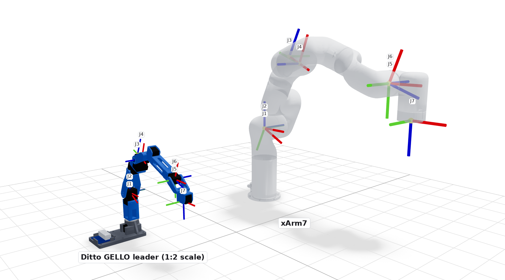
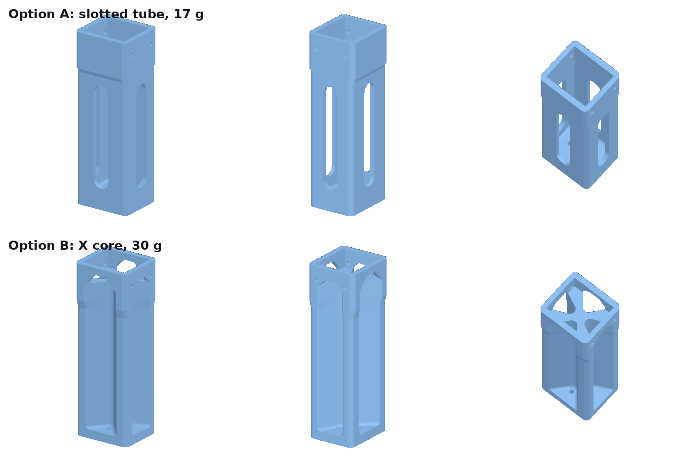

# Ditto GELLO

A 3D-printed leader arm for teleoperating the uFactory xArm7, half the xArm7's size, built around Dynamixel servos
in the style of [FACTR](https://github.com/JasonJZLiu/FACTR_Hardware).

Every joint frame of the leader is the xArm7's joint frame at half scale. The same seven joint angles therefore put
both arms in the same pose, with no kinematic mapping in between.



*The leader (blue) and the xArm7 at the same joint angles, with joint frames J1–J7 drawn on both. The xArm7 is drawn
see-through so its frames show.*

**Status:** designed in CAD and checked by analysis (kinematics, fit, stress). Nothing has been printed or built yet,
so expect to tune clearances.

## What is in this folder

| Path | Contents |
|---|---|
| `view.py` | viewer: both arms on the same joint sliders |
| `urdf/ditto_leader_2xm.urdf`, `urdf/ditto_leader_3xm.urdf` | the leader, in its two variants, with link 5 option A |
| `urdf/ditto_leader_2xm_link5b.urdf`, `urdf/ditto_leader_3xm_link5b.urdf` | the same with link 5 option B |
| `urdf/meshes/` | meshes the leader URDFs use (printed links, servos, base) |
| `urdf/xarm7/` | the xArm7 model shown beside the leader |
| `urdf/ditto_hands/` | the Ditto hand models: the follower (`ditto_follower_7dof`) and leader (`ditto_leader_7dof`) from [roamlab/ditto](https://github.com/roamlab/ditto/tree/reverse_teleop), and the newer leader models built from the SolidWorks export, `ditto_leader_2f` (index and thumb; the one the viewer puts on the leader arm) and `ditto_leader_3f` (adds the middle finger), drop-in replacements for `ditto_leader_7dof` (see `urdf/ditto_hands/README.md`) |
| `stl/2xm/`, `stl/3xm/` | the printed parts, `link1.stl` to `link6.stl`, one full set per variant; link 5 comes as `link5a.stl` and `link5b.stl` |
| `stl/FACTR_base.stl` | the printed base, FACTR's unchanged, the same for both variants |
| `BUILD_2xm.md` | step-by-step build guide for the `2xm` variant, with pictures and the screw for every step |
| `requirements.txt` | Python packages the viewer needs |
| `licenses/` | licence of the FACTR parts included here |

## Run the viewer

```bash
pip install -r requirements.txt
python view.py
```

Then open http://localhost:8080. Tested with Python 3.11.

- **Joints:** seven sliders move the leader and the xArm7 together. **Poses** has presets, including the joint limits.
- **Zero:** puts every joint at 0, the xArm7's zero, where every servo should also read zero. Red pins are a horn's
  top, right, bottom and left screw holes at servo zero (white = top); yellow pins are the holes of the part bolted to
  it (blue = the part's top-hole mark). At Zero they coincide.
- **leader:** switches between the two variants.
- **link 5:** switches between the two forearm options.
- **xArm7:** shows it beside the leader at full size, on top of the leader at half scale (the frames coincide), or
  hides it.
- **Show:** turns joint frames, printed parts and servos on and off.
- **Ditto hands:** "show the hands" puts the Ditto follower hand on the xArm7's flange (grey) and the Ditto leader
  hand on the leader's flange (orange); `python view.py --hands` starts with them on. See below.

`python view.py --port 8090` uses another port; `--variant 3xm` starts on the other variant; `--link5 b` starts with link 5 option B.

### The Ditto hands

The follower hand's model has its own mount: its root link, `hand_mount`, is the xArm7's flange (`link7`), and its
fixed joint `hand_mount` → `palm` (xyz 0, 0, 10 mm; rpy 0, 90, 90°) holds the 10 mm connector and the hand's turn
about the flange axis. The leader hand's model has no mount: its root link is `hand_piece`, and the viewer places it
on the leader's `link7`.

- **Rotation** (`LEADER_HAND_RPY` in `view.py`): rpy -90, 0, -90°. It makes the leader hand's finger axes parallel
  to those of the follower hand on the xArm7, so both hands point the same way at equal arm joint angles.
- **Offset** (`LEADER_MOUNTS`, the "leader hand mount" list): still an open choice. With xyz -6.3, -42.2, 78.6 mm the
  leader hand sits on its flange exactly as the follower sits on the xArm7's (the index and first thumb joint axes
  coincide), but the hand then touches link 6. 10 mm further out along the flange axis it clears link 6 by 5 mm.
  The "half offset" entry is there for comparison: it would put the pinch point at half scale like the arm, but the
  full-size hand ends up inside the wrist.
- **shift x / y / z:** moves the leader hand from the chosen mount, in the flange frame. The text under the sliders
  gives the resulting `link7` → `hand_piece` transform and where the pinch point (red ball) is from each flange.
- **Fingers:** the same seven angles drive both hands. The teleop offsets between leader and follower fingers are
  not applied.

## The two variants

| Variant | XM430-W210 at | XC330-T288 at | Moving mass beyond the shoulder |
|---|---|---|---|
| `2xm` | J2, J4 | J1, J3, J5, J6, J7 | about 301 g |
| `3xm` | J2, J3, J4 | J1, J5, J6, J7 | about 364 g |

They differ only in `link2` and `link3`. `3xm` is the one to build for force feedback: its upper-arm roll joint (J3)
has a metal horn and a stronger servo. Both need two XM430 idler sets (J2, J4) and one XC330 idler (J6), as FACTR
does.

## Link 5: two options

Link 5 is the forearm. It exists in two versions that fit the same arm, with the same screws. Neither has been
printed yet; both are kept until they have been tested. Print one.



| | `link5a.stl` | `link5b.stl` |
|---|---|---|
| Shape | tube with a slot in each face | solid X, as FACTR's forearm |
| Estimated mass | 18 g | 30 g |
| Worst stress in analysis (safety factor) | 11.5 MPa (2.6) | 8.9 MPa (3.4) |
| Worst deflection in analysis | 0.7 mm | 0.6 mm |
| Horn screws | long driver down the tube | in the open channels, reachable from outside |

Option B adds about 12 g to the arm. The joint ranges are the same for both.

## Printing

- Print one `stl/FACTR_base.stl` and one set of `link1.stl` to `link6.stl` from the variant you build, with either
  `link5a.stl` or `link5b.stl` as link 5.
- `FACTR_base.stl` is FACTR's base (bearing seat, servo 1 mount, U2D2 and power hub holder), unchanged, and already
  sits flat on the print bed. It is the grey part in the viewer. FACTR's base assembly shows how the bearing, servo 1
  and electronics go in.
- `link2.stl` to `link6.stl` are already turned the way they should sit on the print bed.
- `link1.stl` is in its own joint frame. It follows FACTR's link 1, so print it the way FACTR prints theirs. Its horn screws go down four wells cut for a stepped bit driver (12 mm of thin bit, then a 4 mm bit base, then 7 mm, then 10.5 mm).
- Every part that bolts to a servo horn has a small groove marking its top hole. Set the servo to its zero position and
  put that groove on the horn's top hole (the one towards the servo's short end).
- Suggested settings: PLA, 0.2 mm layers, 5 perimeters, 6 top and bottom layers, 40 % gyroid infill.
- `link2` has a solid tower. Print it at lower infill (about 20 %) to save weight; the mass above assumes that.
- Use a brim on `link4` and on the `3xm` `link2`; they stand on a small footprint.
- `link3`, `link4`, `link6` and the `3xm` `link2` need some support. Both link 5 options and the `2xm` `link2` need none.

## Assembly guide

**[BUILD_2xm.md](BUILD_2xm.md) is the step-by-step build guide for the `2xm` variant**, with a picture of every step
and the screw to use in it. The servo setup below is the same for both variants.

### Servo setup

Set up every servo before it goes into the arm. The servos are the same two models FACTR uses. They all ship with
ID 1 at 57600 bps, so connect them to the U2D2 one at a time and set each one with
[Dynamixel Wizard 2.0](https://emanual.robotis.com/docs/en/software/dynamixel/dynamixel_wizard2/). FACTR's
"Update Servo IDs" step shows where to click.

| Setting | Address | Set to | Factory default |
|---|---|---|---|
| ID | 7 | the joint number, 1 to 7 (table below) | 1 |
| Baud Rate | 8 | 4000000 bps (value `6`) | 57600 bps (value `1`) |
| Return Delay Time | 9 | 0 | 500 µs (value `250`) |

The addresses and values are the same for both servo models.

The ID is the joint number, counted from the base:

| ID | Joint | `2xm` | `3xm` |
|---|---|---|---|
| 1 | J1 | XC330-T288-T | XC330-T288-T |
| 2 | J2 | XM430-W210-T | XM430-W210-T |
| 3 | J3 | XC330-T288-T | XM430-W210-T |
| 4 | J4 | XM430-W210-T | XM430-W210-T |
| 5 | J5 | XC330-T288-T | XC330-T288-T |
| 6 | J6 | XC330-T288-T | XC330-T288-T |
| 7 | J7 | XC330-T288-T | XC330-T288-T |

- All three settings can only be changed while torque is off, and they are kept when power is removed.
- To find a servo again after this, scan at 4000000 bps.
- Write the ID on each servo, so the right one goes into each joint.

## Not included

- **Handle.** The arm ends at servo 7's horn, which has four M2 holes for a handle or gripper trigger of your own.

## About the URDFs

- Joints are `joint1` to `joint7`, with the xArm7's joint limits. `link7` is the tool flange.
- Masses and inertias are estimates from CAD volume and nominal servo masses.
- Collision geometry is the printed parts as meshes and the servos as boxes.

## Credits

- [FACTR_Hardware](https://github.com/JasonJZLiu/FACTR_Hardware) (Apache-2.0): the design this arm follows. The
  base (`stl/FACTR_base.stl`) and the bearing and servo meshes in `urdf/meshes/` are taken from it, and link 1
  follows its link 1. Its licence is in `licenses/`.
- [xarm_ros2](https://github.com/xArm-Developer/xarm_ros2) by UFACTORY (BSD-3-Clause): the xArm7 model in
  `urdf/xarm7/`, with its licence beside it.
- [GELLO](https://github.com/wuphilipp/gello_software): the idea of a small leader arm with the follower's kinematics.
